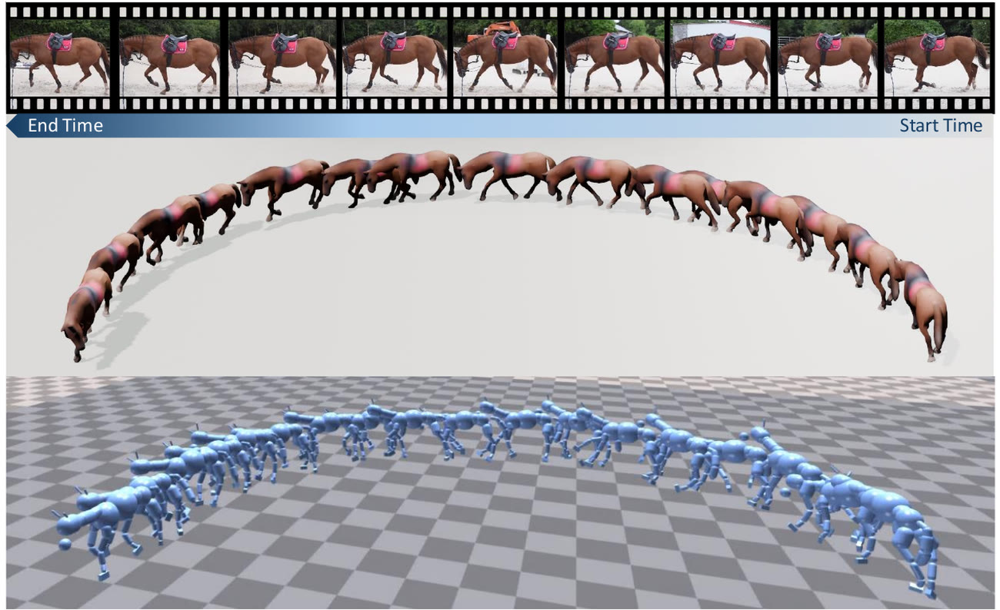
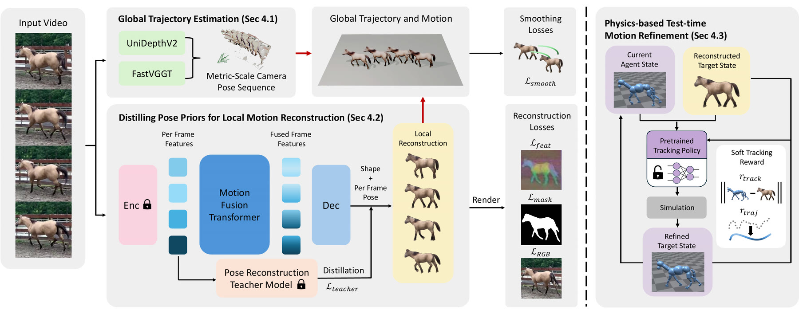

# PhysPony: Physics-Aware Global Horse Motion Reconstruction from In-the-Wild Videos

[Yiming Huang](https://yh2371.github.io/), [Siyu Li](https://www.grasp.upenn.edu/people/siyu-li/), [Qiao Feng](https://fengq1a0.github.io/), [Lingjie Liu](https://lingjie0206.github.io/)

University of Pennsylvania · SIGGRAPH Asia 2026

[Project Page](https://yh2371.github.io/physpony) · [Paper]({{PAPER_URL}})

[](https://yh2371.github.io/physpony)

PhysPony reconstructs globally consistent, physically plausible horse motion from a monocular video:

1. **Global trajectory**: metric-scale camera trajectory from FastVGGT and UniDepthV2.
2. **Local articulation**: a motion fusion transformer, distilled from Dessie, predicts hSMAL shape and pose.
3. **Physics refinement**: a mocap-pretrained tracking policy is finetuned in simulation for each sequence.



## Installation

```bash
conda env create -f environment/physpony.yml       # trajectory + kinematic model
conda env create -f environment/physpony-sim.yml   # physics (Python 3.8, required by Isaac Gym)
```

For `physpony-sim`, also install [Isaac Gym Preview 4](https://developer.nvidia.com/isaac-gym): `pip install -e <isaacgym>/python`.

## Data and checkpoints

**PhysPony files.** Download everything from [this Google Drive folder](https://drive.google.com/drive/folders/1oWVmUBLNOfJP6Cmg9kKLXbInh5yN0qVJ):

| File | Place in |
|------|----------|
| `kinematic.pth` (kinematic model) | `checkpoints/physpony/kinematic.pth` |
| `tracking_policy.pt` (mocap-pretrained tracking policy) | `checkpoints/physpony/tracking_policy.pt` |
| `physpony_sim_motions.zip` (reference motions, for training the tracking policy) | unzip in the repository root |

**Dessie and hSMAL.** Follow the [Dessie README](https://github.com/Celiali/Dessie) to download the hSMAL model files (including `6D_meanpose.npz`) and the pretrained Dessie weights, and the UV map (`uvmap/`) linked in Dessie's [data.md](https://github.com/Celiali/Dessie/blob/main/data.md). Then:

- copy the hSMAL files and the `uvmap/` folder into both `model/model/geometry/SMAL/` and `sim/mimickit/SMAL/`;
- place the Dessie checkpoint (`best.ckpt`) at `checkpoints/dessie/best.ckpt`.

**FastVGGT.** Download the checkpoint from [FastVGGT](https://github.com/mystorm16/FastVGGT) to `checkpoints/fastvggt/model_tracker_fixed_e20.pt`.

UniDepthV2 weights download automatically. All paths can be changed in `configs/paths.sh`.

## Usage

Put each video in its own folder as frames `{frame}_rgb.jpg` with masks `{frame}_mask.png` and boxes `{frame}_box.txt`, then:

```bash
conda activate physpony
bash scripts/run_trajectory.sh data/videos       # stage 1
bash scripts/run_kinematics.sh data/videos       # stage 2 -> outputs/kinematics

conda activate physpony-sim
bash scripts/run_physics.sh data/videos          # stage 3 -> outputs/physics/<seq>_states.npz
```

Physics refinement takes about 7 hours per sequence on one L40 (`HOURS=` to change it). `ZERO_SHOT=1` rolls out the pretrained policy without finetuning.

## Training

```bash
conda activate physpony
cd model && python run.py --config-name train_physpony_horse_stage2
```

## Evaluation

PASCAL keypoint transfer (KT-PCK):

```bash
cd model
python eval/prepare_pascal_eval_set.py --help
python run.py --config-name eval_pascal_kp checkpoint_path=../checkpoints/physpony/kinematic.pth test_result_dir=../outputs/pascal
python eval/eval_kt_pck.py --results_dir ../outputs/pascal --keypoints ../data/eval/pascal_kp/keypoints.json
```

## Acknowledgements

This code builds on [FastVGGT](https://github.com/mystorm16/FastVGGT), [UniDepth](https://github.com/lpiccinelli-eth/UniDepth), [3DAnimals](https://github.com/3DAnimals/3DAnimals), [DESSIE](https://github.com/Celiali/DESSIE) and [MimicKit](https://github.com/xbpeng/MimicKit). Their licenses are kept in the corresponding folders.

## Citation

```bibtex
@inproceedings{huang2026physpony,
  title     = {PhysPony: Physics-Aware Global Horse Motion Reconstruction from In-the-Wild Videos},
  author    = {Huang, Yiming and Li, Siyu and Feng, Qiao and Liu, Lingjie},
  booktitle = {SIGGRAPH Asia 2026 Conference Papers},
  year      = {2026}
}
```
